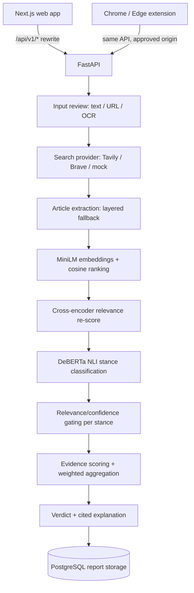

# Architecture

## Overview

The web application is a Next.js App Router interface. A same-origin rewrite
sends `/api/v1/*` to FastAPI. Server-rendered investigation/share routes call
that API origin directly with caching disabled. The extension talks to the
same API through an explicitly approved web origin and contains no ML logic
of its own — every model runs server-side.

## Request lifecycle: a typed-claim investigation

1. The web app POSTs the reviewed claim(s) to `POST /api/v1/investigations`.
2. FastAPI validates the request against a Pydantic schema (length, count,
   input-type bounds) and applies a per-peer, per-process rate limit.
3. For each atomic claim, `collect_evidence` queries the configured search
   provider, deduplicates candidate URLs, downloads bounded public HTML, and
   extracts passages (`article_extraction.py`'s layered fallback: strict
   Trafilatura → permissive Trafilatura → structured page metadata → visible
   text as a last resort).
4. Candidate passages are deduplicated, capped per domain for source
   diversity, embedded with MiniLM, and ranked by cosine similarity against
   the claim (`retrieval.py`).
5. The top-ranked passages are re-scored for relevance with a cross-encoder
   (`proposition_model`), and each is classified support/contradict/neutral
   by the local NLI model (`nli.py`).
6. `gate_stance` (`pipeline.py`) excludes low-relevance or low-confidence
   evidence — contradiction evidence uses its own, separately calibrated
   relevance floor, since general-purpose gating was found to under-count
   genuine contradictions (see `docs/remediation-final-report.md`).
7. Retained evidence is scored (`relevance × stance confidence × source
   weight`) and aggregated into separate support/contradiction totals per
   atomic claim, producing one of the four verdicts (see the root README).
8. The investigation, its assessments, and the evidence used are persisted
   to PostgreSQL (or a bounded in-memory store in fixture mode without a
   database) and returned to the client.

URL and image (OCR) inputs run an equivalent but shorter lifecycle first:
`POST /api/v1/inputs/url` or `/inputs/text` extracts article text and
proposes candidate claim sentences for review; `POST /api/v1/inputs/image`
runs local OCR (RapidOCR/ONNX) and returns extracted text for the user to
correct before any claim is proposed. Investigation always runs on the
user-reviewed/edited text, never directly on raw OCR or extraction output.

## Storage

PostgreSQL stores the report tables through parameterized Psycopg
transactions. Sources are reused by URL within one investigation. Embeddings
are transient and never persisted. Numbered SQL migration files are applied
once, under a transaction/advisory lock. No ORM, queue, vector database, or
microservice layer is used — the request volume and consistency needs of
this project don't justify that complexity.

A bounded 100-report in-memory store is allowed only in fixture mode when no
database is configured, deliberately temporary and unsuitable for durable
shared reports. Reports are only saved once the synchronous investigation
completes; there is no persistent background-job layer.

## Security boundaries

Sharing creates an unguessable slug via an explicit user action. The report
route is read-only with no accounts; possession of a URL grants access to
its visible contents. Raw input text stays out of API report responses.
Provider/database exceptions become safe, structured errors — internal
exception details and stack traces are never returned to the client (see
`api/app/core/errors.py`).

Request limits are per direct peer and per API process, ignoring forwarded
headers by default; this is not distributed abuse control. The intended
deployment exposes only the web server through HTTPS, with the API and
PostgreSQL kept internal. A single API worker is the supported setup — see
`docs/deployment.md` for the full deployment shape and its open items.

### First-run configuration

The web provider gate reads configuration-only status before rendering
input. Fixture mode bypasses credentials entirely. Live mode requires search
credentials and a database connection string; actual connectivity is
checked separately (`/api/v1/ready`). Optional localhost-only setup
validates a key through the selected provider and holds it in backend
process memory — never written to disk or returned through any API
response. Environment-configured credentials always take precedence over a
runtime-submitted key, and public deployments must leave runtime entry
disabled. See `docs/final-configuration.md` for the exact threat boundary
and restart behavior.

## Why these dependencies

- **FastAPI + Pydantic**: strict request/response validation with minimal
  boilerplate, and async-friendly for I/O-bound search/extraction calls.
- **Trafilatura, with a layered fallback**: a well-maintained, boilerplate-
  aware article extractor; the fallback chain exists because it alone still
  missed real, legitimately-extractable pages (see the remediation report).
- **Sentence-Transformers MiniLM**: small enough to run comfortably on CPU
  for interactive request latency, while still giving a useful first-pass
  relevance ranking before the more expensive re-score/NLI steps.
- **A cross-encoder relevance model** as a second, more precise relevance
  signal on the smaller top-K set — cheap because it only runs on already
  cosine-filtered candidates, but materially more accurate than embedding
  similarity alone at telling "about the same topic" from "actually
  relevant to this claim."
- **DeBERTa-v3-large NLI (MNLI/FEVER/ANLI-trained)**: chosen after
  benchmarking several practical local-CPU candidates — it won on every
  axis measured (macro F1, contradiction precision/recall) at a real but
  acceptable latency/memory cost. See `settings.py`'s inline comment and
  `docs/hyper-final-reliability-report.md` for the comparison.
- **RapidOCR (ONNX Runtime)**: a CPU-friendly OCR engine with no GPU
  dependency, matching this project's local-first constraint.
- **PostgreSQL, no ORM**: a handful of well-understood tables and
  parameterized SQL were simpler to reason about and test than an ORM layer,
  for this project's actual query patterns.
- **Plain Manifest V3 JavaScript for the extension**: no build step, no
  framework dependency, and no ML logic duplicated client-side — it's a
  thin client over the same API the web app uses.
